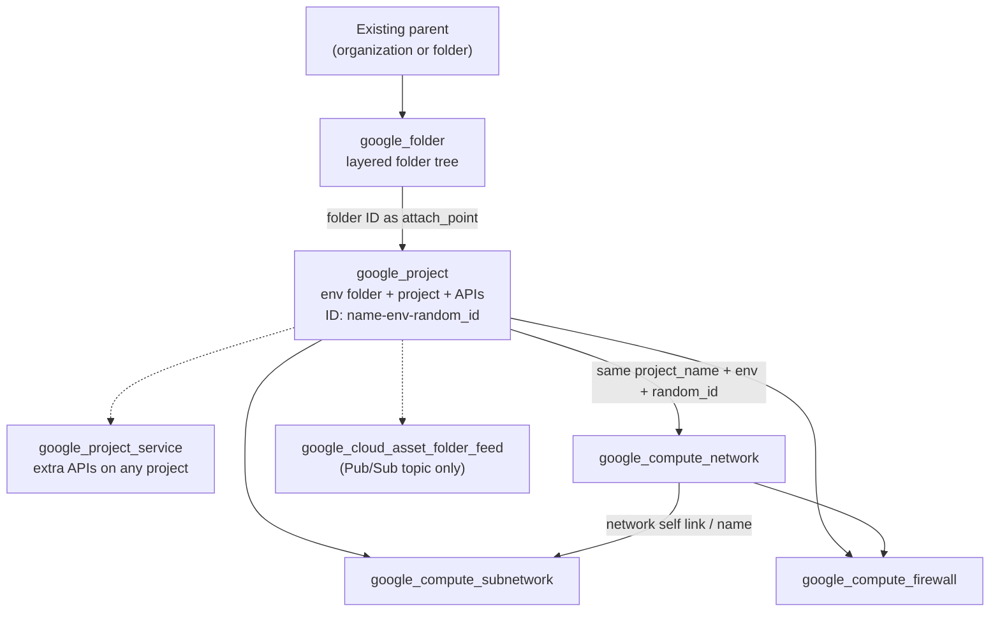
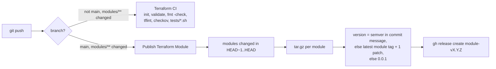

# terraform

A collection of small Terraform modules for Google Cloud (folders, projects, APIs, VPC networks, subnets, firewall
rules), with GitHub Actions that lint changed modules and publish each one as a versioned GitHub Release.

## Description

Each directory under `modules/` wraps one Google Cloud resource type and takes a **list or map of objects**, so a
single module call can create many resources of that type from data (for example, every VPC of every environment).
The project-level modules share a naming convention, `<project_name>-<env>-<random_id>`, which lets networks,
subnets and firewall rules be placed into the projects created by `google_project` without passing project IDs
around.

The repository is also an experiment in per-module release automation: every push to `main` that touches a module
tars that module and publishes it as a GitHub Release tagged `<module>-v<semver>`.

Audience: anyone building a Google Cloud landing zone or multi-environment project layout in Terraform who wants
data-driven building blocks to copy or reference.

## Features

| Module | Creates | Inputs | Outputs |
|---|---|---|---|
| `google_folder` | Folder hierarchy up to 10 levels deep from a flat map | `folders` | `id` (broken, see Status) |
| `google_project` | One folder + one project per environment under an attach point, and enables listed APIs | `attach_point`, `project_name`, `random_id`, `environments` | `folders`, `projects`, `google_project_names` |
| `google_project_service` | Enables a list of APIs on one project | `gcp_project`, `enabled_services` | none |
| `google_compute_network` | VPC networks (custom subnet mode, regional routing, MTU 1460 by default) | `project_name`, `random_id`, `networks` | `google_project_vpc` (name to network ID) |
| `google_compute_subnetwork` | Subnets with optional secondary ranges and flow logs | `project_name`, `random_id`, `sub_networks` | none (output block commented out) |
| `google_compute_firewall` | Firewall rules with optional allow/deny blocks and logging | `project_name`, `random_id`, `firewalls` | none |
| `google_cloud_asset_folder_feed` | Only a Pub/Sub topic `cloud-asset-project-feed`; the asset feed itself is commented out | `project_name`, `folder_feed_config` | none |

## Architecture

How the modules fit together:



And the CI/CD pipeline:



More detail in [docs/ARCHITECTURE.md](docs/ARCHITECTURE.md).

## Requirements

- Terraform `>= 1.3` (modules use `optional()` object attributes). CI pins Terraform 1.9.2.
- The `hashicorp/google` provider. **No version is pinned**; `google_project` only validates with provider 5.x or
  older (see Status).
- Google Cloud credentials with rights to create folders and projects (organization-level roles such as Folder
  Creator and Project Creator) and to manage networking in the target projects.
- For CI locally (optional): `tflint` and `checkov`.

## Installation and quick start

Reference a module from Git, pinned to a release tag:

```hcl
module "projects" {
  source = "git::https://github.com/Lapeyus/terraform.git//modules/google_project?ref=<tag>"

  attach_point = "folders/000000000000"
  project_name = "demo"
  random_id    = "a1b2"

  environments = [
    {
      name            = "dev"
      billing_account = "000000-000000-000000"
      services        = ["compute.googleapis.com"]
    },
  ]
}

module "vpc" {
  source = "git::https://github.com/Lapeyus/terraform.git//modules/google_compute_network?ref=<tag>"

  project_name = "demo"
  random_id    = "a1b2"
  networks     = [{ name = "main", env = "dev" }]

  depends_on = [module.projects]
}
```

Release tags follow `<module>-v<semver>`; list them with `git ls-remote --tags https://github.com/Lapeyus/terraform.git`.
Each release also carries a `<module>.tar.gz` asset with the module's files.

Then:

```bash
terraform init
terraform plan
```

## Usage

More input examples:

```hcl
# google_folder: flat map, hierarchy via parent_entry_key
module "folders" {
  source = "git::https://github.com/Lapeyus/terraform.git//modules/google_folder?ref=<tag>"
  folders = {
    platform = { external_parent_id = "organizations/000000000000" }
    shared   = { parent_entry_key = "platform" }
    network  = { parent_entry_key = "shared", name = "Network" }
  }
}

# google_compute_subnetwork
sub_networks = [{
  name                     = "gke-us-central1"
  env                      = "dev"
  network                  = "main"
  gcp_region               = "us-central1"
  subnetwork_cidr          = "10.10.0.0/20"
  private_ip_google_access = true
  secondary_ip_range = [
    { name = "pods", ip_cidr_range = "10.20.0.0/16" },
    { name = "services", ip_cidr_range = "10.30.0.0/20" },
  ]
}]

# google_compute_firewall
firewalls = [{
  env           = "dev"
  name          = "allow-iap-ssh"
  network       = "main"
  priority      = 1000
  direction     = "INGRESS"
  source_ranges = ["35.235.240.0/20"]
  allow         = { protocol = "tcp", ports = ["22"] }
}]
```

All values above are placeholders.

## Repository structure

```
.
├── modules/
│   ├── google_folder/                   # up to 10 levels of folders from one map
│   ├── google_project/                  # per-env folder + project + API enablement
│   ├── google_project_service/          # enable APIs on an existing project
│   ├── google_compute_network/          # VPC networks
│   ├── google_compute_subnetwork/       # subnets, secondary ranges, flow logs
│   ├── google_compute_firewall/         # firewall rules
│   └── google_cloud_asset_folder_feed/  # Pub/Sub topic; asset feed is a commented-out draft
├── docs/
│   └── ARCHITECTURE.md
└── .github/workflows/
    ├── terraform-ci.yml                 # lint/validate changed modules on non-main branches
    └── publish-terraform-module.yml     # tag + GitHub Release per changed module on main
```

Each module follows `main.tf` / `variables.tf` / `outputs.tf` (where outputs exist). There is no root module, no
backend configuration and no provider block: callers supply all of those.

## Configuration

- Module inputs are documented in each `variables.tf` and summarized in the Features table.
- The publish workflow needs a repository secret named `PAT` (a GitHub token allowed to create releases). It is
  configured in GitHub, not in the repository.
- No `.tfvars`, state files or credentials are stored here. The repository has no `.gitignore`; if you run Terraform
  inside it, do not commit `.terraform/`, `*.tfstate*` or `*.tfvars`.

## Tests

There are no Terraform tests (`tests/` directories are supported by CI but none exist). Results of
`terraform init -backend=false && terraform validate` and `terraform fmt -check` per module, run with
Terraform 1.15.8 and google provider 8.9.0 on 2026-10-27:

| Module | validate | fmt |
|---|---|---|
| `google_cloud_asset_folder_feed` | ok | ok |
| `google_compute_firewall` | ok | ok |
| `google_compute_network` | ok | ok |
| `google_compute_subnetwork` | ok | ok |
| `google_project_service` | ok | ok |
| `google_folder` | **fails**: output references undeclared `local.folder_id` | ok |
| `google_project` | **fails**: `skip_delete` is no longer a `google_project` argument (removed in provider 6.0) | ok |

To reproduce for one module:

```bash
cd modules/google_compute_network
terraform init -backend=false
terraform validate
terraform fmt -check
```

## Deployment

Releases are automatic: merge or push a change under `modules/` to `main`. To choose the version, put a semver such as
`1.2.0` in the commit message; otherwise the patch number of the module's latest tag is incremented (first release:
`0.0.1`).

## Project status

**Experiment, inactive.** An initial commit on 2023-04-28, then a single day of CI/CD iteration on 2024-07-23 (about
48 short commits). No activity since. Only one release tag exists, `google_project_service-v0.0.1`.

Known limitations:

- `google_folder` and `google_project` fail `terraform validate` (see Tests).
- `google_project` iterates over `env.services` without a default, so an environment without `services` breaks the
  plan.
- `google_folder` accepts `iam` and `iam_mode` but does not use them.
- `google_compute_firewall` declares an unused `clusters` variable.
- `google_cloud_asset_folder_feed` creates only the Pub/Sub topic; its name says "project feed" and the module is a
  draft.
- No `required_providers` / `required_version` blocks, so provider upgrades can break modules silently.
- Both workflows only look at `HEAD~1..HEAD`; a push with several commits only lints or releases modules changed in the
  last one. Module names are used as environment variable names in the publish job.
- CI runs `terraform init` at the repository root, which has no configuration, and then validates each module
  without a per-module `init`, so the validate step fails with "Missing required provider" (reproduced locally).

## License

No license file. All rights reserved by the author unless a license is added.
